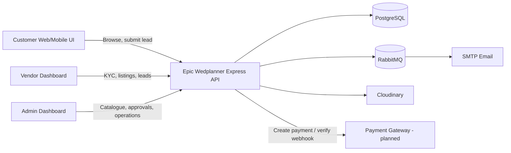
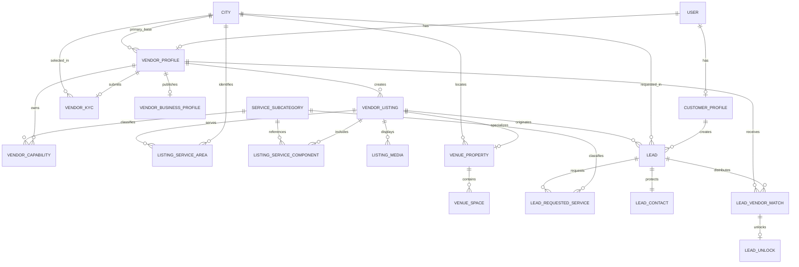
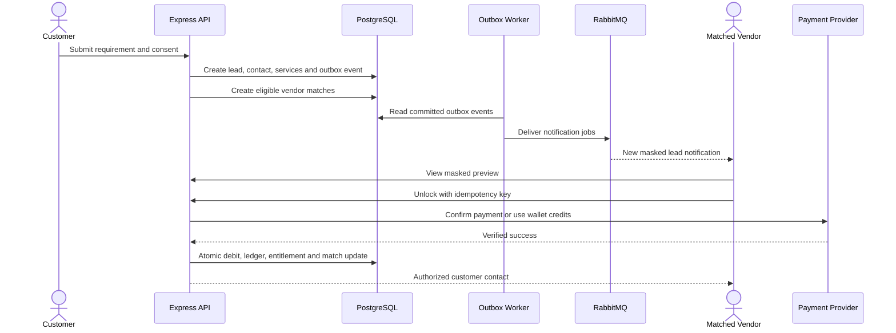

# Epic Wedplanner Marketplace and Lead Platform Architecture

**Status:** Approved architecture; marketplace foundation implemented  
**Document version:** 1.1  
**Date:** 12 October 2026  
**Repository:** Epic_Wedplanner backend  
**Audience:** Product owner, backend developers, frontend developers, QA, operations, and future payment-integration teams

> This document combines the implemented marketplace foundation with the planned listing, lead, and monetization phases. Each section identifies what exists now and what remains planned.

### Suggested reading order

- Product/business overview: Sections 1-6
- Database and domain design: Sections 8-10
- Vendor/customer workflows: Sections 11-13
- API, permissions, and privacy: Sections 14-18
- Delivery plan: Sections 23-28

## 1. Executive summary

Epic Wedplanner should be built as a lead-generation marketplace with four clearly separated concepts:

1. **KYC** verifies that a vendor and its legal/business identity are trustworthy.
2. **Vendor capabilities** describe the services an approved vendor is allowed to offer.
3. **Marketplace listings** describe the public offers customers can discover and enquire about.
4. **Leads and matches** capture customer demand, route it to relevant vendors, and create the monetization opportunity.

The vendor should not be classified as a "single-service vendor" or a "multiple-service vendor." A vendor may publish any number of listings. A normal service listing contains one service component, while a combined service listing contains multiple service components.

Only two top-level listing kinds are required:

```text
SERVICE
VENUE_PROPERTY
```

Examples:

- `Wedding Planning` is a `SERVICE` listing with one component.
- `Wedding Planning + Venue Sourcing + Decoration` is one `SERVICE` listing with three components.
- `Royal Palace Banquet Hall` is a `VENUE_PROPERTY` listing with physical-property fields such as address, capacity, rooms, spaces, parking, and policies.

The recommended initial monetization model is paid lead access: customers submit requirements for free, qualified vendors see a masked lead preview, and a vendor spends credits or pays to unlock the customer's contact details. Subscriptions, promoted listings, and commissions can be added later.

The system should remain a **modular monolith** using the project's existing Express, Prisma, PostgreSQL, RabbitMQ, Cloudinary, JWT, and Zod stack. Microservices are unnecessary at the current scale and would add operational complexity without solving a present problem.

## 2. How this architecture was derived

This architecture is not copied from a competitor's private implementation. It is derived from Epic Wedplanner's business rules and standard relational modelling.

| Business rule | Required relationship | Design result |
| --- | --- | --- |
| One vendor may provide many services | Vendor to service catalogue is many-to-many | `VendorCapability` |
| One vendor may publish many offers | Vendor to listing is one-to-many | `VendorListing` |
| One offer may contain several services | Listing to service catalogue is many-to-many | `ListingServiceComponent` |
| A physical venue has different attributes | Optional one-to-one specialization | `VenueProperty` |
| A venue has multiple halls/lawns/spaces | Venue to space is one-to-many | `VenueSpace` |
| One customer requirement may contain several services | Lead to service catalogue is many-to-many | `LeadRequestedService` |
| One lead may be offered to several vendors | Lead to vendor is many-to-many | `LeadVendorMatch` |
| Each vendor independently unlocks a lead | One unlock per vendor/lead match | `LeadUnlock` |

These records are separate because they have different owners, visibility rules, approval rules, and lifecycles. For example, changing a public listing must not rewrite legal KYC history, and rejecting one listing must not reject the vendor's identity.

## 3. Current repository state

### 3.1 What exists today

The current repository is a backend JSON API. It uses the following layers:

```text
Route -> Controller -> Service -> Repository -> Prisma -> PostgreSQL
```

The following features are implemented:

- Client and vendor registration
- Email verification and login
- JWT access/refresh tokens
- Password reset
- Google authentication
- Role authorization for `SUPER_ADMIN`, `ADMIN`, `VENDOR`, and `CLIENT`
- Vendor KYC submission and admin approval/rejection
- KYC document upload through Cloudinary
- Service category and subcategory administration
- Public category/subcategory discovery
- Normalized city administration and public city discovery
- An editable public section on `VendorProfile`
- Normalized approved `VendorCapability` records created during KYC approval
- Vendor profile/capability APIs and a safe public vendor-profile endpoint
- RabbitMQ-backed OTP email delivery

Relevant existing files:

- [`README.md`](../README.md) describes the application as an authentication/KYC backend.
- [`prisma/schema/user.prisma`](../prisma/schema/user.prisma) defines accounts and roles.
- [`prisma/schema/vendorProfile.prisma`](../prisma/schema/vendorProfile.prisma) defines KYC state plus the vendor's editable public-profile fields.
- [`prisma/schema/vendorKyc.prisma`](../prisma/schema/vendorKyc.prisma) stores KYC business information and selected catalogue ID arrays.
- [`prisma/schema/vendorCapability.prisma`](../prisma/schema/vendorCapability.prisma) stores normalized, approved service capabilities.
- [`prisma/schema/city.prisma`](../prisma/schema/city.prisma) defines normalized marketplace cities.
- [`prisma/schema/serviceCategory.prisma`](../prisma/schema/serviceCategory.prisma) defines normalized categories and subcategories.
- [`src/services/vendorKyc/index.js`](../src/services/vendorKyc/index.js) validates catalogue selections and handles KYC workflow.
- [`src/middlewares/kyc.middleware.js`](../src/middlewares/kyc.middleware.js) contains the KYC-approved authorization gate that can protect future listing and lead routes.

### 3.2 What does not exist yet

The following are planned and require implementation:

- Vendor listing creation and moderation
- Combined-service listings
- Venue-property data and venue spaces
- Listing media galleries
- Public listing browse/search/detail APIs
- Customer enquiries/leads
- Lead-to-vendor matching
- Vendor lead inbox
- Paid lead unlocking
- Wallet/payment ledger
- Reviews, quotes, bookings, availability, and commissions
- Customer-facing, vendor-facing, and admin frontend applications

### 3.3 Important gaps in the current model

1. KYC still stores selected category and subcategory IDs as PostgreSQL string arrays. They remain the submitted audit snapshot; marketplace querying uses normalized `VendorCapability` rows instead.
2. KYC contains private legal/document data and must never be exposed as the public vendor profile.
3. Approved KYC is intentionally locked, while the public fields on `VendorProfile` remain editable.
4. Listing, lead, matching, and monetization records are not implemented yet.
5. The upload system has KYC and logo purposes but needs dedicated listing/venue gallery purposes.
6. There is no frontend code in this repository. The API contracts in this document are intended for a separate frontend application.
7. KYC currently has one strict final submission endpoint and no server-side draft endpoint. A multi-step frontend must either keep an unfinished draft locally or a later API must add explicit draft persistence.

## 4. Product scope

### 4.1 MVP goals

The minimum viable marketplace must allow:

1. An admin to maintain the service catalogue.
2. A vendor to register, submit KYC, and become approved.
3. An approved vendor to maintain a public business profile.
4. An approved vendor to create a service listing containing one or more services.
5. An approved venue vendor to create a physical venue-property listing.
6. An admin to approve or reject submitted listings.
7. A customer to browse and filter published listings.
8. A customer to request a quote from a listing or submit a general requirement.
9. The system to match a lead with qualified vendors.
10. A vendor to view a masked lead and unlock it.
11. Administrators to audit listings, leads, matches, unlocks, and payments.

### 4.2 Explicit MVP non-goals

The first marketplace release should not attempt to build:

- AI-based matching
- Real-time bidding between vendors
- A complete booking engine
- Escrow or marketplace payouts
- Vendor calendar synchronization
- Dynamic surge pricing
- Complex package builders
- Multi-currency settlement
- A microservice architecture

These can be introduced after the listing-to-lead funnel has real usage data.

## 5. Domain terminology

| Term | Meaning |
| --- | --- |
| Service category | Admin-managed parent grouping, such as Wedding Planning or Makeup |
| Service subcategory | Selectable leaf offering, such as Full Wedding Planning or Bridal Makeup |
| KYC | Private legal and business verification submission |
| Vendor capability | Approved catalogue item that a vendor is allowed to offer |
| Vendor business profile | Editable, safe, public-facing vendor identity |
| Listing | Public offer shown in the marketplace |
| Service component | One catalogue service included inside a service listing |
| Combined listing | A service listing with two or more service components |
| Venue property | A real physical hall, hotel, resort, lawn, farmhouse, or similar property |
| Venue assistance | A normal service where a planner helps find or book a venue; it is not a venue property |
| Lead | Customer requirement or request for a quote |
| Lead match | Decision to offer a lead to a particular vendor |
| Lead unlock | Vendor's paid access to the customer's protected contact information |

## 6. Core architecture decisions

### 6.1 Use a modular monolith

Keep one deployable Express API and one PostgreSQL database. Organize new modules using the existing application convention:

```text
src/routes/<scope>/...
src/controllers/...
src/services/...
src/repositories/...
src/validators/...
prisma/schema/<entity>.prisma
```

RabbitMQ should remain an asynchronous delivery mechanism for email and notifications. It should not become the source of truth; PostgreSQL remains authoritative.

### 6.2 Do not model “solo vendor” and “multiple-service vendor”

A vendor account has one `VENDOR` role and may create many listings. The listing's component count determines whether the offer is simple or combined:

```text
1 service component  -> normal service listing
2+ components        -> combined service listing
```

No `SINGLE_VENDOR`, `MULTIPLE_VENDOR`, `SOLO`, or `BUNDLE_VENDOR` account type is needed.

### 6.3 Separate a service from a physical venue

Use `SERVICE` when a vendor performs work, including venue sourcing or coordination.

Use `VENUE_PROPERTY` only when the listing represents a physical property. A property requires dedicated structured fields and may contain multiple event spaces.

### 6.4 Keep KYC, capabilities, profiles, and listings separate

```text
KYC                = private verification evidence
Capability         = what the vendor is approved to provide
Business profile   = who the vendor is publicly
Listing            = what the vendor is selling publicly
```

Safe business information may be copied from an approved KYC into an editable public profile, but public APIs must never read and return the KYC object directly.

### 6.5 Moderate public listings independently

KYC approval permits a vendor to use marketplace features. Each listing should still have its own draft/review/publish lifecycle so misleading or incomplete content can be rejected without disabling the entire vendor account.

### 6.6 Hide direct contact information if monetizing leads

If Epic Wedplanner earns money from lead access, public marketplace responses should not expose vendor/customer phone numbers, WhatsApp numbers, email addresses, or external links that bypass the enquiry flow. Internal/admin endpoints may access them according to authorization policy.

## 7. High-level system context



## 8. Recommended domain model



The diagram is logical. Final Prisma relation names may be adjusted to fit code style, but the cardinalities and ownership boundaries should remain.

## 9. Catalogue design

### 9.1 Extend existing categories with an offering kind

The existing `ServiceCategory` and `ServiceSubcategory` tables should remain the catalogue source of truth. Add an explicit discriminator to the parent category rather than relying on a category name or slug:

```text
CatalogOfferingKind
- SERVICE
- VENUE_PROPERTY
```

Recommended addition:

```text
ServiceCategory.offeringKind
ServiceCategory.isActive
ServiceSubcategory.isActive
```

Examples:

| Category | offeringKind | Example subcategories |
| --- | --- | --- |
| Wedding Planning | `SERVICE` | Full Planning, Day Coordination |
| Makeup | `SERVICE` | Bridal Makeup, Party Makeup |
| Venue Assistance | `SERVICE` | Venue Sourcing, Booking Coordination |
| Venue Properties | `VENUE_PROPERTY` | Banquet Hall, Hotel, Resort, Farmhouse |

This prevents the frontend from using fragile rules such as `if slug === "venue-services"`.

### 9.2 Catalogue rules

- A selectable subcategory must always belong to exactly one parent category.
- Listings should reference IDs, not copy category names.
- Normal catalogue items referenced by production data should be deactivated instead of deleted.
- Category/subcategory names may change without breaking listing relations.
- Combined `SERVICE` listings may span multiple `SERVICE` categories.
- A `VENUE_PROPERTY` must select a subcategory belonging to a `VENUE_PROPERTY` category.

## 10. Detailed data design

The following model definitions are conceptual contracts. Exact Prisma syntax should be implemented in separate modular schema files and delivered through reviewed migrations.

### 10.1 Public fields on `VendorProfile` — implemented

Purpose: editable public identity, logically separate from the related private `VendorKyc` snapshot without creating another one-to-one profile table.

| Field | Type | Rules |
| --- | --- | --- |
| `userId` | String | Primary key and FK to `User.id` |
| `kycStatus` | Enum | Verification workflow state; not exposed by the public serializer |
| `businessName` | String? | Required before setting the profile active |
| `slug` | String? | Globally unique public URL, initialized on approval |
| `about` | String? | Required before setting the profile active |
| `logoUrl` | String? | Public Cloudinary URL |
| `logoPublicId` | String? | Used for managed replacement/deletion |
| `primaryCityId` | String? | FK to normalized `City`; required before activation |
| `profileStatus` | Enum | `DRAFT`, `ACTIVE`, `SUSPENDED` |
| `createdAt` / `updatedAt` | DateTime | Audit timestamps |

Direct contact details remain in protected account/business records and are not returned in public marketplace responses.

KYC submission updates only `VendorProfile.kycStatus`. It does not copy public fields. A new submission must include an active `primaryCityId` selected from `GET /api/v1/cities`; `VendorKyc` stores that relation plus the selected `City.name` in `primaryOperatingCity` as a readable snapshot. The KYC also stores a separate legal business-address snapshot, including the required free-form address city and an India-only country code normalized to `IN`. On admin approval, the transaction assigns the still-active stored ID to `VendorProfile.primaryCityId` and initializes `businessName`, `about`, and `slug` once. Legacy KYC rows without an ID may use name-based fallback matching. The vendor may then edit public profile values independently, while `VendorKyc` remains the verification snapshot.

### 10.2 `VendorCapability`

Purpose: normalized list of services the vendor may use when creating listings and when matching general leads.

| Field | Type | Rules |
| --- | --- | --- |
| `id` | String | Primary key |
| `vendorUserId` | String | FK to `VendorProfile` |
| `serviceSubcategoryId` | String | FK to `ServiceSubcategory` |
| `status` | Enum | `PENDING`, `APPROVED`, `REJECTED`, `INACTIVE` |
| `source` | Enum | `KYC`, `VENDOR_REQUEST`, `ADMIN` |
| `reviewedAt` / `reviewedByAdminId` | Nullable | Approval audit |
| timestamps | DateTime | Audit timestamps |

Constraints and indexes:

```text
UNIQUE(vendorUserId, serviceSubcategoryId)
INDEX(serviceSubcategoryId, status)
INDEX(vendorUserId, status)
```

On initial KYC approval, valid selected subcategories are upserted as `APPROVED` capabilities inside the approval transaction. Later, an approved vendor can directly replace its selected active categories/subcategories with `PUT /vendor/capabilities`; this updates only that vendor's capability rows and does not change the admin-owned catalog or require KYC resubmission.

### 10.3 Location and service-area models

`City` is the normalized location catalogue. An admin first creates supported cities, and the vendor frontend loads active choices from `GET /api/v1/cities`. New KYC submissions require one selected `primaryCityId`; they do not accept vendor-entered `primaryOperatingCity` text. The backend stores both `VendorKyc.primaryCityId` and the selected `City.name` in `VendorKyc.primaryOperatingCity`. The ID powers relations and matching, while the name is a readable historical snapshot of what was submitted.

The KYC legal business address is independent of that catalogue relation. `businessAddress.city` records the vendor-entered city appearing in the office/registration address, and it may differ from the primary operating city. `businessAddress.countryCode` is required; while the marketplace is India-only, the API accepts `IN` case-insensitively and persists the normalized `IN` value. These address fields are verification data and must not be used as substitutes for `primaryCityId` in marketplace search or lead matching.

The location models are:

```text
City
- id
- name
- slug
- stateName
- countryCode (default IN)
- isActive

ListingServiceArea
- listingId
- cityId
- isPrimary

UNIQUE(listingId, cityId)
```

Rules:

- A new KYC submission must reference one active `City` through `primaryCityId`.
- A new KYC submission must include `businessAddress.city` and `businessAddress.countryCode`; the current India-only contract permits only `IN` and normalizes it to uppercase.
- The legal business-address city may differ from the primary operating city.
- KYC approval assigns that still-active ID directly to `VendorProfile.primaryCityId`; legacy KYC rows without the ID may use name-based fallback matching.
- `VendorProfile.primaryCityId` represents exactly one main business/base city, not every city the vendor serves.
- A `SERVICE` listing must have at least one service area before submission.
- A `SERVICE` listing may have multiple `ListingServiceArea` rows, allowing one vendor's listings to cover different sets of cities.
- A `VENUE_PROPERTY` has one fixed physical `cityId`; it is not treated as serving many cities.
- A lead uses a required `cityId` for deterministic matching while retaining optional human-readable address/event notes.
- During migration, map legacy KYC city strings to catalogue cities and send ambiguous values to an admin reconciliation report.
- Radius/pincode/geospatial matching can be added after city-level matching is validated.

### 10.4 `VendorListing`

Purpose: common parent for every marketplace card and detail page.

| Field | Type | Rules |
| --- | --- | --- |
| `id` | String | CUID primary key |
| `vendorUserId` | String | FK to `VendorProfile` |
| `kind` | Enum | `SERVICE` or `VENUE_PROPERTY` |
| `title` | String | Required, customer-facing |
| `slug` | String | Unique public URL |
| `shortDescription` | String | Card/SEO summary |
| `description` | String | Full detail |
| `priceType` | Enum | `FIXED`, `STARTING_FROM`, `CONTACT_FOR_PRICE` |
| `startingPricePaise` | BigInt? | Nullable only where price type permits |
| `currency` | String | Default `INR` |
| `primaryCityId` | String? | Primary service city; venue city is also stored in venue details |
| `status` | Enum | Listing lifecycle state |
| `submittedAt` | DateTime? | Review audit |
| `publishedAt` | DateTime? | Marketplace ordering |
| `reviewedAt` | DateTime? | Admin audit |
| `reviewedByAdminId` | String? | Admin identifier |
| `rejectionReason` | String? | Required when rejected |
| timestamps | DateTime | Audit timestamps |

Store money in integer paise to avoid floating-point errors. Use a PostgreSQL/Prisma `BigInt`-compatible column rather than a 32-bit integer so large event budgets cannot overflow. For example, INR 25,000 is stored as `2500000` paise. Serialize BigInt amounts through an explicit API money serializer rather than passing raw Prisma BigInts to `JSON.stringify`.

Recommended indexes:

```text
UNIQUE(slug)
INDEX(vendorUserId, status)
INDEX(kind, status, publishedAt)
INDEX(primaryCityId, status, publishedAt)
```

Maintain an append-only moderation history rather than relying only on the latest fields on the listing:

```text
ListingModerationEvent
- id
- listingId
- action: SUBMITTED | APPROVED | REJECTED | PAUSED | RESUMED | ARCHIVED
- actorUserId
- fromStatus
- toStatus
- reason (nullable)
- createdAt
```

### 10.5 `ListingServiceComponent`

Purpose: services contained inside a `SERVICE` listing.

| Field | Type | Rules |
| --- | --- | --- |
| `id` | String | Primary key |
| `listingId` | String | FK to `VendorListing`, cascade on listing delete while draft |
| `serviceSubcategoryId` | String | FK to catalogue, restrict deletion |
| `isPrimary` | Boolean | Exactly one component must be primary |
| `titleOverride` | String? | Optional customer-facing label |
| `includedDescription` | String | What this component includes |
| `componentPricePaise` | Int? | Optional breakdown; listing price remains authoritative |
| `displayOrder` | Int | Stable presentation order |

Constraints:

```text
UNIQUE(listingId, serviceSubcategoryId)
INDEX(serviceSubcategoryId, listingId)
```

Use a partial unique database index for one primary component per listing where practical (`WHERE isPrimary = true`). Because Prisma may not express every partial index declaratively, the migration may include reviewed PostgreSQL SQL. The service layer must still validate the invariant transactionally.

Application validation must guarantee:

- A `SERVICE` listing has at least one component.
- Every selected subcategory belongs to a `SERVICE` category.
- Every selected subcategory is an approved vendor capability.
- Exactly one component has `isPrimary = true`.
- The listing has at least one normalized service area.
- A `VENUE_PROPERTY` listing has no service components in the MVP.

### 10.6 `ListingMedia`

Purpose: controlled gallery for services and venues.

| Field | Type | Rules |
| --- | --- | --- |
| `id` | String | Primary key |
| `listingId` | String | FK to listing |
| `mediaType` | Enum | Start with `IMAGE`; allow `VIDEO` later |
| `url` | String | Cloudinary URL |
| `publicId` | String | Ownership and deletion control |
| `altText` | String? | Accessibility and SEO |
| `isCover` | Boolean | At most one cover per listing |
| `displayOrder` | Int | Stable ordering |

Add upload purposes such as `listing-image` and `venue-image`. Validate that the Cloudinary public ID belongs to the authenticated vendor and expected listing path before persistence.

Enforce one cover image per listing with a partial unique index where practical, and validate/reorder media inside a transaction.

### 10.7 `VenueProperty`

Purpose: details that apply only to a physical venue.

| Field | Type | Notes |
| --- | --- | --- |
| `listingId` | String | Primary key and FK to `VendorListing` |
| `venueTypeSubcategoryId` | String | Banquet Hall, Hotel, Resort, etc. |
| `addressStreet` / `locality` | String | Physical location |
| `cityId` / `pincode` | String | Normalized city FK plus postal code |
| `latitude` / `longitude` | Decimal? | Optional map support |
| `minimumCapacity` | Int? | Guest range |
| `maximumCapacity` | Int | Must be greater than or equal to minimum |
| `roomCount` | Int? | Optional accommodation |
| `parkingCapacity` | Int? | Optional |
| `cateringPolicy` | Enum? | In-house, outside allowed, etc. |
| `alcoholPolicy` | Enum? | Policy-specific value |
| `hasAccommodation` | Boolean | Search filter |
| `terms` | String? | Property rules |

The venue subtype must belong to a category whose `offeringKind` is `VENUE_PROPERTY`.

### 10.8 `VenueSpace`

Purpose: individual bookable/displayable areas belonging to a venue.

```text
VenueSpace
- id
- venueListingId
- name
- spaceType
- indoorOutdoor
- seatedCapacity
- floatingCapacity
- areaSquareFeet (optional)
- pricePaise (optional)
- displayOrder
```

Examples include Grand Ballroom, Garden Lawn, Rooftop, Poolside, and Conference Hall. These are venue spaces, not marketplace service listings.

Require at least one venue space for publication unless product policy explicitly permits a property-level listing with no separately named space.

### 10.9 `Lead`

Purpose: private customer requirement, either from a listing or a general request form.

| Field | Type | Rules |
| --- | --- | --- |
| `id` | String | Primary key |
| `customerUserId` | String? | Nullable for approved guest-lead strategy |
| `sourceListingId` | String? | Set for direct Request Quote flow |
| `eventDate` | DateTime? | Customer may be undecided |
| `cityId` | String | Required normalized event city for matching |
| `budgetMinPaise` / `budgetMaxPaise` | BigInt? | Valid range |
| `guestCount` | Int? | Important for venues |
| `requirement` | String | Free-text details |
| `status` | Enum | Lead lifecycle |
| `consentAt` | DateTime | Evidence of contact/data-sharing consent |
| timestamps | DateTime | Audit timestamps |

Customer contact information should be stored in a separate one-to-one `LeadContact` record. This makes accidental exposure through marketplace or matching queries less likely.

```text
LeadContact
- leadId (primary key and FK)
- encryptedName
- encryptedEmail (nullable)
- encryptedPhone
- phoneVerifiedAt (nullable)
- emailVerifiedAt (nullable)
- createdAt
- updatedAt
```

Encrypt sensitive contact values where the deployment's key-management capability supports it. Public/vendor preview queries must not join `LeadContact`. An unlocked-contact service should perform the authorization check and return only the minimum necessary fields.

### 10.10 `LeadRequestedService`

Purpose: normalized requested services for matching.

```text
LeadRequestedService
- leadId
- serviceSubcategoryId
- source: LISTING | CUSTOMER_SELECTED | ADMIN

UNIQUE(leadId, serviceSubcategoryId)
```

When a customer requests a quote from a combined listing, copy all listing service components into the lead. This keeps the historical request stable even if the vendor edits the listing later.

For a venue-property enquiry, retain `sourceListingId` and add the venue subtype to the requested-service classification if needed for matching/reporting.

### 10.11 `LeadVendorMatch`

Purpose: independent delivery and sales state for each vendor offered a lead.

| Field | Type | Rules |
| --- | --- | --- |
| `id` | String | Primary key |
| `leadId` | String | FK to lead |
| `vendorUserId` | String | FK to vendor |
| `matchedListingId` | String? | Best matching listing |
| `matchScore` | Int | Explainable 0-100 score |
| `status` | Enum | Delivery/response state |
| `pricePaise` | BigInt | Unlock price snapshot; later pricing changes do not affect this offer |
| `deliveredAt` / `viewedAt` | DateTime? | Funnel analytics |
| `expiresAt` | DateTime? | Optional availability window |

Constraints:

```text
UNIQUE(leadId, vendorUserId)
INDEX(vendorUserId, status, deliveredAt)
INDEX(leadId, status)
```

### 10.12 `LeadUnlock`, payment, and wallet ledger

Purpose: immutable proof that a vendor paid for access to a lead.

Minimum fields:

```text
LeadUnlock
- id
- leadVendorMatchId (unique)
- vendorUserId
- amountPaise
- creditsUsed
- paymentReference (nullable)
- idempotencyKey (unique)
- unlockedAt
```

If prepaid credits are used, implement an append-only wallet ledger:

```text
VendorWallet
- vendorUserId
- cachedCreditBalance
- updatedAt

WalletLedgerEntry
- id
- vendorUserId
- type: PURCHASE | LEAD_UNLOCK | REFUND | ADJUSTMENT
- creditDelta
- amountPaise
- referenceType
- referenceId
- idempotencyKey
- createdAt
```

The unlock operation must run in one database transaction that:

1. Locks or conditionally updates the wallet balance.
2. Confirms the match is eligible and not already unlocked.
3. Debits credits or confirms a successful payment.
4. Creates the immutable ledger entry.
5. Creates `LeadUnlock`.
6. Changes match status to `UNLOCKED`.

Repeated requests with the same idempotency key must return the original result without charging again.

## 11. State machines

### 11.1 KYC state — current

```text
PENDING -> SUBMITTED -> APPROVED
                    -> REJECTED -> SUBMITTED
APPROVED -> REJECTED (admin correction path currently supported)
```

The existing system deactivates a vendor while KYC is submitted and reactivates it after approval/rejection. This behavior should be reviewed from a product-experience perspective, but marketplace routes must always enforce `APPROVED` regardless.

### 11.2 Listing state — planned

```text
DRAFT -> PENDING_REVIEW -> PUBLISHED
                       -> REJECTED -> DRAFT
PUBLISHED -> PAUSED
PUBLISHED -> ARCHIVED
PAUSED -> PUBLISHED
```

Rules:

- Vendors can edit freely in `DRAFT`.
- Submission validates completeness and sets `PENDING_REVIEW`.
- Material edits to a published listing should either create a review revision or return it to review.
- Rejection requires an admin reason.
- Archived listings are not hard-deleted.
- Every moderation action should append an immutable `ListingModerationEvent`; `rejectionReason` on the listing is only the latest convenient summary.

If an admin changes an approved vendor's KYC to `REJECTED`, the same transaction or a reliable follow-up workflow must suspend the public profile, inactivate capabilities, and pause published listings. Public marketplace queries must still filter by `VendorProfile.kycStatus = APPROVED` as defense in depth.

### 11.3 Lead state — planned

```text
NEW -> QUALIFIED -> DISTRIBUTED -> CONTACTED -> CONVERTED
  \         \             \           -> CLOSED
   -> INVALID -> CLOSED     -> EXPIRED
```

Lead status describes the overall customer requirement. Vendor-specific progress belongs in `LeadVendorMatch`.

### 11.4 Lead match state — planned

```text
OFFERED -> VIEWED -> UNLOCKED -> CONTACTED -> WON
       \         \           \           -> LOST
        -> EXPIRED -> DECLINED
```

## 12. End-to-end workflows

### 12.1 Vendor onboarding and capability creation

```text
Vendor registers
  -> verifies email
  -> selects service categories/subcategories during KYC
  -> uploads legal documents
  -> submits KYC
  -> admin reviews
  -> admin approves
  -> system initializes safe public fields on the VendorProfile draft
  -> system upserts approved VendorCapability rows
  -> vendor enters dashboard
```

KYC arrays remain as the legal submission snapshot. Capabilities become the relational operational data.

### 12.2 Service listing creation

```text
Vendor chooses “Create Service Listing”
  -> frontend loads approved capabilities
  -> vendor selects one or more services
  -> vendor provides one public title and overall description
  -> vendor describes each included component
  -> vendor enters pricing/location
  -> vendor uploads gallery
  -> saves draft
  -> previews
  -> submits for review
  -> admin approves
  -> listing becomes searchable
```

There is no required “solo or multiple” question. The form begins with one component and provides an **Add another included service** action.

```mermaid
sequenceDiagram
    actor V as Vendor
    participant API as Express API
    participant DB as PostgreSQL
    actor A as Admin
    participant M as Marketplace

    V->>API: Create SERVICE draft with 1..N components
    API->>DB: Validate ownership and approved capabilities
    DB-->>API: Draft saved transactionally
    API-->>V: Draft/preview response
    V->>API: Submit listing
    API->>DB: Validate completeness; set PENDING_REVIEW
    A->>API: Approve listing
    API->>DB: Append moderation event; set PUBLISHED
    M->>API: Search published listings
    API-->>M: Public safe listing view
```

### 12.3 Combined-service example

Request payload concept:

```json
{
  "kind": "SERVICE",
  "title": "Complete Wedding Solution",
  "shortDescription": "Planning, venue assistance and decoration in one service.",
  "description": "We manage your wedding from planning through execution.",
  "priceType": "STARTING_FROM",
  "startingPricePaise": 50000000,
  "currency": "INR",
  "primaryCityId": "delhi-city-id",
  "serviceAreaCityIds": ["delhi-city-id", "gurugram-city-id", "noida-city-id"],
  "services": [
    {
      "serviceSubcategoryId": "full-wedding-planning-id",
      "isPrimary": true,
      "includedDescription": "Planning, timelines and vendor coordination."
    },
    {
      "serviceSubcategoryId": "venue-sourcing-id",
      "isPrimary": false,
      "includedDescription": "Venue research, visits and negotiation support."
    },
    {
      "serviceSubcategoryId": "wedding-decoration-id",
      "isPrimary": false,
      "includedDescription": "Theme, stage, entrance and floral decor."
    }
  ]
}
```

This produces one marketplace card and one detail page. It does not produce three independent listings unless the vendor separately chooses to create them.

### 12.4 Venue-property creation

```text
Vendor chooses “Create Venue Property”
  -> selects property type
  -> enters physical address
  -> enters capacity/accommodation/parking/policies
  -> adds one or more venue spaces
  -> adds pricing and gallery
  -> previews and submits
  -> admin reviews and publishes
```

If a wedding planner provides venue sourcing but does not own/manage a property, the planner must create a `SERVICE` component called Venue Sourcing/Assistance, not a venue property.

### 12.5 Customer marketplace flow

```text
Customer opens marketplace
  -> filters by service or venue type, city, price, capacity, and verification
  -> opens listing
  -> sees public vendor profile and other published listings
  -> selects Request Quote
  -> confirms event details and contact consent
  -> lead is created
```

### 12.6 Lead matching and distribution

```text
Lead created
  -> validate/qualify
  -> identify eligible vendors
  -> score eligible vendors
  -> create 3-5 LeadVendorMatch rows
  -> enqueue vendor notifications
  -> vendors see masked previews
```

Direct-listing enquiry rule:

- The owner of `sourceListingId` should receive the first/direct match if still eligible.
- Additional vendors may receive the lead only if the product policy and customer consent allow comparison.

### 12.7 Lead unlock

```text
Vendor opens lead preview
  -> sees non-identifying requirement details and unlock price
  -> confirms unlock
  -> payment/credit transaction commits atomically
  -> LeadUnlock is created
  -> protected customer contact is returned
  -> audit and notification events are recorded
```



## 13. Matching strategy

### 13.1 Hard eligibility filters

A vendor is eligible only when all applicable conditions are true:

- User account is active.
- KYC status is `APPROVED`.
- Public vendor profile is active.
- Vendor has an approved capability matching at least one requested service.
- Vendor has a relevant published listing, where required by policy.
- Vendor serves the event city/area.
- Source listing is still published for direct enquiries.
- Vendor has not been suspended from leads.

### 13.2 Initial explainable score

A simple first version can score out of 100:

| Signal | Suggested maximum |
| --- | ---: |
| Requested-service overlap | 50 |
| Same city/service area | 20 |
| Budget compatibility | 15 |
| Venue capacity/date suitability | 10 |
| Profile/listing completeness | 5 |

The values are configurable product policy, not database constants. Store the final score and optionally a JSON explanation for operational debugging.

### 13.3 Distribution controls

- Start with at most 3-5 matched vendors per lead.
- Do not create duplicate vendor matches.
- Expire stale offers.
- Track vendor acceptance, unlock, contact, and conversion rates.
- Apply fairness/rate caps so one vendor does not receive every lead.
- Detect spam and duplicate customer enquiries before charging vendors.

AI ranking should be considered only after enough real lead/conversion history exists.

## 14. API design

All routes continue under `/api/v1`. The exact response envelope should reuse the project's existing `sendSuccess` and `ApiError` conventions.

### 14.1 Existing APIs to retain

```text
/auth/*
/uploads/image
/service-categories
/service-subcategories
/vendor/kyc
/admin/vendor-kyc
/admin/service-categories
/admin/service-subcategories
```

### 14.2 Planned vendor profile APIs

```text
GET    /vendor/business-profile
PATCH  /vendor/business-profile
GET    /vendor/capabilities
PUT    /vendor/capabilities
```

`PATCH` edits only public/business-profile fields. It must not mutate KYC legal documents.

### 14.3 Planned vendor listing APIs

```text
POST   /vendor/listings
GET    /vendor/listings
GET    /vendor/listings/:id
PATCH  /vendor/listings/:id
DELETE /vendor/listings/:id              # draft only, otherwise archive
POST   /vendor/listings/:id/submit
POST   /vendor/listings/:id/pause
POST   /vendor/listings/:id/resume
POST   /vendor/listings/:id/media
DELETE /vendor/listings/:id/media/:mediaId
```

All mutation routes require authentication, `VENDOR` role, approved KYC, and ownership checks.

### 14.4 Public marketplace APIs

```text
GET /marketplace/vendors
GET /marketplace/vendors/:slug

# Planned after listing records are implemented
GET /marketplace/listings
GET /marketplace/listings/:slug
GET /marketplace/vendors/:slug/listings
```

`GET /marketplace/vendors` is the unauthenticated discovery endpoint. It returns paginated public vendor cards and supports:

```text
page
limit
search
cityId
serviceCategoryId
serviceSubcategoryId
offeringKind                 # SERVICE or VENUE_PROPERTY
```

The client first loads this collection and then opens `GET /marketplace/vendors/:slug` using the selected card's slug. The collection response uses `data.vendors` and `data.pagination`, and each public item exposes `vendorId` rather than an internal profile record. Both endpoints use an explicit public serializer. A vendor is eligible only when its user account is active, its KYC is `APPROVED`, its profile is `ACTIVE`, and its primary city is active. Returned services are restricted to approved capabilities backed by active categories and subcategories; service filters use those same eligible capabilities. The responses include only `vendorId`, business name, slug, safe description, logo URL, primary city, and service/category data plus list pagination. They never include KYC documents or numbers, legal-address fields, contact details, admin-review data, or internal status fields.

Example listing filters:

```text
kind
serviceCategoryId
serviceSubcategoryId
cityId
priceMinPaise
priceMaxPaise
guestCount
page
limit
sort
```

Only `PUBLISHED` listings belonging to active, KYC-approved vendors may be returned.

### 14.5 Planned customer lead APIs

```text
POST /leads
GET  /client/leads
GET  /client/leads/:id
POST /client/leads/:id/close
```

`POST /leads` may use the existing optional-auth middleware if guest leads are allowed. Before enabling anonymous leads, add phone/email verification and rate limiting.

Example direct-listing request:

```json
{
  "sourceListingId": "listing-id",
  "contactName": "Customer Name",
  "contactPhone": "9876543210",
  "contactEmail": "customer@example.com",
  "eventDate": "2027-02-18",
  "cityId": "delhi-city-id",
  "budgetMinPaise": 40000000,
  "budgetMaxPaise": 70000000,
  "guestCount": 500,
  "requirement": "Need end-to-end planning with venue assistance.",
  "consent": true
}
```

### 14.6 Planned vendor lead APIs

```text
GET  /vendor/leads
GET  /vendor/leads/:matchId/preview
POST /vendor/leads/:matchId/unlock
POST /vendor/leads/:matchId/decline
POST /vendor/leads/:matchId/outcome
```

The preview response must never include protected customer contact fields. The unlocked response must first verify a `LeadUnlock` belonging to the current vendor.

### 14.7 Planned admin APIs

```text
GET  /admin/listings
GET  /admin/listings/:id
POST /admin/listings/:id/approve
POST /admin/listings/:id/reject
POST /admin/listings/:id/suspend

GET  /admin/leads
GET  /admin/leads/:id
POST /admin/leads/:id/qualify
POST /admin/leads/:id/invalidate
POST /admin/leads/:id/rematch

GET  /admin/lead-matches
POST /admin/lead-matches/:id/refund
```

### 14.8 Planned payment APIs

```text
POST /vendor/wallet/payment-orders
GET  /vendor/wallet
GET  /vendor/wallet/transactions
POST /payments/webhooks/:provider
```

Webhook handlers must verify provider signatures and be idempotent. A frontend success redirect is not proof of payment.

### 14.9 Required frontend screens

This repository does not contain a frontend. A separate frontend application should implement at least the following screens against the APIs above.

Customer experience:

```text
Marketplace home/search
Listing results and filters
Service listing detail
Venue property detail
Public vendor profile
Request Quote / Find Vendors form
Lead submission confirmation
Customer lead history (for signed-in clients)
```

Vendor dashboard:

```text
Registration, verification, and KYC wizard
KYC review/rejection status
Business profile editor
Capabilities view/request
Listing list and status filters
Service listing wizard with “Add another included service”
Venue property wizard and venue-space editor
Listing preview
Masked lead inbox and lead detail
Unlock confirmation
Wallet/transaction history (Phase 5)
```

Admin dashboard:

```text
Catalogue and location management
KYC review
Capability-request review
Listing moderation and preview
Lead quality/matching operations
Refund/dispute tools
Audit and funnel reports
```

Frontend forms should use server-provided status and validation responses as the source of truth. They must not infer authorization merely because a button is visible or hidden.

## 15. Authorization and visibility matrix

| Resource/action | Public | Client | Vendor owner | Other vendor | Admin |
| --- | ---: | ---: | ---: | ---: | ---: |
| Published listing | Read | Read | Read | Read | Read/manage |
| Draft listing | No | No | Read/write | No | Read/manage |
| Vendor KYC documents | No | No | Own limited view | No | Authorized review |
| Public vendor profile | Read | Read | Read/write | Read | Read/manage |
| Lead contact details before unlock | No | Own | No | No | Authorized operations |
| Masked lead preview | No | Own | If matched | If matched | Read |
| Unlocked lead contact | No | Own | If valid unlock | No | Authorized operations |
| Wallet/ledger | No | No | Own | No | Finance-authorized admin |

Every repository query for vendor-owned resources must scope by both resource ID and authenticated `vendorUserId`. Never depend only on a frontend-supplied vendor ID.

## 16. Public response design

Create explicit serializers/view models rather than returning raw Prisma records.

### 16.1 Public vendor response may include

- Business name and slug
- Safe description
- Logo/gallery
- Primary city and service areas
- Approved capability names
- Verification badge/status label
- Published listings
- Aggregated ratings later

### 16.2 Public vendor response must not include

- PAN/Aadhaar/GST/CIN numbers or document URLs
- KYC declaration data
- Private phone, WhatsApp, or email when using paid-lead monetization
- Admin review notes
- Internal status history
- Wallet/payment data

### 16.3 Lead preview may include

- Requested service names
- Event city and approximate date
- Budget band
- Guest-count band
- Sanitized requirement summary
- Lead age and unlock price

It must not contain enough information to identify or directly contact the customer before unlock.

## 17. Transactions and consistency

Use Prisma transactions for operations that must succeed or fail together:

1. KYC approval plus capability upsert and safe profile initialization.
2. Listing creation/update plus components, venue details, and ordered media references.
3. Listing submission plus completeness validation/status change.
4. Lead creation plus requested-service snapshot.
5. Matching plus unique `LeadVendorMatch` inserts.
6. Wallet debit plus ledger entry plus lead unlock.
7. Refund plus compensating ledger entry and unlock/match audit.

Do not use RabbitMQ to coordinate money or authoritative status transitions. Commit the database transaction first, then publish notification jobs using an outbox pattern when reliability becomes important.

Do not hard-delete published listings, leads, matches, unlocks, payment events, wallet ledger entries, moderation events, or audit events. Archive or change business status while retaining the evidence required for support, reconciliation, and disputes.

## 18. Security and privacy

### 18.1 Required application controls

- Continue using Zod schemas for every body, query, and route parameter.
- Apply `authenticateUser`, role authorization, and `requireKycApproved` to vendor marketplace mutations.
- Add object-level ownership checks.
- Rate-limit authentication, public search, uploads, lead submission, and unlock attempts.
- Verify lead contact channels to reduce fake leads.
- Sanitize public text and safely render user-generated content.
- Restrict upload MIME types, sizes, purposes, and Cloudinary paths.
- Keep payment webhooks signature-verified and idempotent.
- Audit admin approval, rejection, suspension, manual wallet changes, and refunds.
- Mask PII in logs and error details.
- Never return Prisma entities containing private fields directly.

### 18.2 Data classification

| Class | Examples | Handling |
| --- | --- | --- |
| Public | Published listing title, description, gallery | Public read API |
| Internal | Match score, review notes, operational status | Authorized staff/vendor views |
| Personal | Customer name, phone, email, event details | Protected, purpose-limited access |
| Highly sensitive | Aadhaar/PAN documents and numbers | KYC-only access, masked, audited |
| Financial | Payments, wallet ledger, refunds | Restricted and immutable audit trail |

Define retention/deletion policies with legal counsel before production, especially for identity documents and customer contact data.

## 19. Search and performance

### 19.1 MVP

PostgreSQL is sufficient for initial marketplace search. Use indexed filters and pagination. Search only published listings and select only public fields.

Recommended query indexes include:

- Listing `(status, kind, publishedAt)`
- Listing `(primaryCityId, status)` and service-area `(cityId, listingId)`
- Component `(serviceSubcategoryId, listingId)`
- Vendor capability `(serviceSubcategoryId, status)`
- Lead `(status, createdAt)`
- Lead `(cityId, eventDate)`
- Match `(vendorUserId, status, deliveredAt)`

### 19.2 Later scale

Add PostgreSQL full-text/trigram search before adopting a separate search cluster. Consider Elasticsearch/OpenSearch only when measured search requirements exceed PostgreSQL capabilities.

Use cursor pagination for high-volume listing/lead feeds later; existing catalogue pagination can remain page-based.

## 20. Notifications

Notification events should include:

- KYC approved/rejected
- Listing submitted/approved/rejected
- New lead matched
- Lead about to expire
- Lead unlocked
- Wallet credits purchased/low balance
- Customer/vendor follow-up reminders

Reuse RabbitMQ for asynchronous email jobs. Future channels may include SMS, WhatsApp, and push notifications, but each requires consent and provider-specific compliance.

Notifications must not be the only record that an action happened. The corresponding database state must exist first.

## 21. Observability and operations

At minimum, production should have:

- Structured logs with request ID, actor ID, action, and safe resource IDs
- Central error reporting
- API latency and error-rate metrics
- Queue depth/failure monitoring
- Database backup and restore testing
- Payment webhook failure alerts
- Audit records for privileged actions
- Health/readiness endpoints that check required dependencies appropriately

Business dashboards should track:

```text
Vendor registration -> KYC submit -> KYC approval
Listing draft -> submit -> publish
Marketplace impression -> detail view -> lead submit
Lead created -> matched -> viewed -> unlocked -> contacted -> won
Credits purchased -> credits spent -> refunds
```

## 22. Testing strategy

### 22.1 Unit tests

- Zod validation
- Status-transition rules
- Pricing and money conversion
- Match scoring
- Public/private serializers
- Capability/listing compatibility rules

### 22.2 Repository/integration tests

- Foreign-key and unique constraints
- Listing creation transaction
- KYC approval capability upsert
- Lead snapshot creation
- Duplicate match prevention
- Concurrent unlock protection
- Wallet debit and refund integrity

Use a real PostgreSQL test database for Prisma integration behavior; mocks cannot prove transactional or constraint correctness.

### 22.3 API authorization tests

- Vendor cannot edit another vendor's listing.
- Unapproved vendor cannot publish or unlock.
- Public endpoint never leaks KYC/contact/financial data.
- Vendor without an unlock cannot see lead contact information.
- Repeated unlock request does not double-charge.
- Non-admin cannot approve/reject listings.

### 22.4 End-to-end acceptance journeys

1. Register vendor -> approve KYC -> create service listing -> publish -> customer lead -> unlock.
2. Create combined listing with services across two categories -> verify one public listing page.
3. Create venue property with two spaces -> filter by city/capacity -> request quote.
4. Reject incomplete listing -> vendor edits -> resubmits -> approve.
5. Submit duplicate/fake lead -> invalidate -> ensure vendor is not charged or receives refund according to policy.

## 23. Migration and implementation roadmap

### Phase 0 — Confirm product policies and clean catalogue

- Confirm lead-sales business model.
- Decide whether guest customers can submit leads.
- Separate Venue Assistance (`SERVICE`) from physical Venue Properties (`VENUE_PROPERTY`).
- Add `offeringKind` to catalogue categories.
- Import and validate the category/subcategory dataset using real returned IDs rather than placeholders.

**Exit condition:** every selectable catalogue item has an unambiguous offering kind.

### Phase 1 — Public profile and capabilities — implemented

- Extend `VendorProfile` with public business-profile fields.
- Add `VendorCapability`.
- Backfill approved capabilities from valid KYC subcategory arrays.
- Update KYC approval transaction to upsert capabilities and initialize the public-profile draft.
- Add vendor profile/capability APIs.
- Add allowlisted self/public serializers that never expose KYC or contact data.

**Exit condition:** an approved vendor has an editable public profile and normalized approved capabilities.

### Phase 2 — Listings and moderation

- Add listing enums and models.
- Add service components, venue details, venue spaces, and listing media.
- Add listing upload purposes.
- Implement vendor CRUD, preview, and submit endpoints.
- Implement admin review endpoints.
- Add ownership, KYC, and status-transition tests.

**Exit condition:** vendors can publish both combined services and venue properties through admin moderation.

### Phase 3 — Public marketplace

- Implement public listing search/detail endpoints.
- Integrate the existing public vendor-profile endpoint with published listings.
- Add listing filters, pagination, safe serializers, SEO slugs, and publication rules.
- Build customer/vendor/admin frontend pages in the frontend repository.

**Exit condition:** customers can browse published listings without private-data leakage.

### Phase 4 — Leads and matching

- Add lead, requested-service, and match models.
- Build direct Request Quote and general requirement endpoints.
- Add verification, consent, spam controls, and qualification.
- Implement rule-based eligibility and scoring.
- Build vendor lead inbox and masked preview.
- Add notifications and funnel analytics.

**Exit condition:** a real customer enquiry can safely reach several relevant vendors.

### Phase 5 — Monetization

- Select payment provider and final credit policy.
- Add wallet, immutable ledger, payment orders, and webhooks.
- Implement atomic/idempotent unlock.
- Add admin refund/dispute tools.
- Add reconciliation and financial reporting.

**Exit condition:** vendors can pay once to unlock a valid lead, and every financial action is auditable.

### Phase 6 — Optimization

- Reviews and ratings
- Quotes and booking outcomes
- Vendor subscriptions
- Featured/promoted listings
- Availability/calendar support
- Better ranking using measured conversion data
- Commission flow only if bookings and payment collection move onto the platform

## 24. Backfill strategy for current KYC selections

Current KYC rows contain category and subcategory ID arrays. Backfill should:

1. Process only approved vendors initially.
2. Read each selected subcategory ID.
3. Confirm the subcategory still exists.
4. Confirm its parent category is consistent with the submitted category array.
5. Upsert `VendorCapability` with source `KYC` and status `APPROVED`.
6. Report missing/stale IDs for manual admin resolution.
7. Never silently invent a capability from a copied service name.

The old arrays should remain in historical KYC records. Do not destructively remove them during the first marketplace migration.

## 25. Proposed source-code module layout

```text
prisma/schema/
  city.prisma
  vendorProfile.prisma
  vendorCapability.prisma
  vendorListing.prisma
  listingServiceArea.prisma
  listingServiceComponent.prisma
  listingMedia.prisma
  listingModerationEvent.prisma
  venueProperty.prisma
  venueSpace.prisma
  lead.prisma
  leadContact.prisma
  leadRequestedService.prisma
  leadVendorMatch.prisma
  leadUnlock.prisma
  outboxEvent.prisma
  auditEvent.prisma
  vendorWallet.prisma                 # Phase 5
  walletLedgerEntry.prisma            # Phase 5

src/controllers/
  vendorProfile.controller.js
  vendorListing.controller.js
  marketplace.controller.js
  lead.controller.js
  vendorLead.controller.js
  payment.controller.js               # Phase 5

src/services/
  vendorProfile/
  vendorListing/
  marketplace/
  lead/
  leadMatching/
  payment/                             # Phase 5

src/repositories/
  vendorProfile.repository.js
  vendorListing.repository.js
  marketplace.repository.js
  lead.repository.js
  leadMatch.repository.js
  wallet.repository.js                # Phase 5

src/validators/
  vendorProfile.validator.js
  vendorListing.validator.js
  marketplace.validator.js
  lead.validator.js
  vendorLead.validator.js
  payment.validator.js                # Phase 5
```

Avoid one oversized marketplace service file. Keep business operations grouped by domain while preserving the existing layered style.

## 26. Key product decisions still requiring confirmation

Recommended defaults are provided so engineering can proceed without redesigning the data model.

| Decision | Recommended MVP default |
| --- | --- |
| Can a service listing include several services? | Yes, across multiple `SERVICE` categories |
| Separate solo/multiple listing types? | No; derive from component count |
| Can a physical venue be embedded directly into a service listing? | No; create a separate venue listing and link/cross-sell later |
| Must a listing service be an approved capability? | Yes |
| Can vendors add capabilities after KYC? | Yes, by directly replacing their selected active category/subcategory capabilities |
| Can guest users submit leads? | Yes only with contact verification and consent; otherwise require client login for first release |
| How many vendors receive one lead? | Start with maximum 3-5 |
| Monetization | Paid lead unlock using prepaid credits |
| Are direct contacts visible publicly? | No, because that bypasses lead monetization |
| Are listings auto-published? | No, admin review for MVP |
| Are prices mandatory? | Permit `CONTACT_FOR_PRICE`, but encourage starting price for ranking/conversion |
| Payment provider | Choose during Phase 5; isolate behind a provider adapter |
| Booking commission | Not in MVP |

## 27. Risks and mitigations

| Risk | Mitigation |
| --- | --- |
| KYC data leaks into public responses | Separate model and explicit public serializers |
| Vendors advertise unapproved services | Require approved capability for each component |
| Category names are used as business logic | Add explicit catalogue offering kind |
| Fake/low-quality leads cause vendor complaints | Contact verification, qualification, spam checks, refunds, audit trail |
| Vendor is charged twice | Unique unlock, idempotency key, atomic transaction |
| Customer details leak before payment | Separate preview/unlocked serializers and authorization tests |
| Concurrent wallet spends create negative balance | Transactional conditional debit/row locking |
| Published listing edits bypass moderation | Revision or return-to-review policy |
| Too many vendors receive the same lead | Recipient cap, expiry, fairness policy |
| Overengineering delays launch | Modular monolith and phased delivery |

## 28. Definition of a successful first release

The first marketplace release is successful when the following journey works reliably:

```text
Admin maintains catalogue
  -> Vendor completes KYC
  -> Admin approves vendor
  -> Vendor creates one listing containing one or several services
  -> Admin publishes listing
  -> Customer finds listing and requests a quote
  -> System sends a masked lead to eligible vendors
  -> Vendor unlocks the lead exactly once
  -> Vendor receives authorized customer contact details
  -> Admin can audit the full journey
```

That journey should be proven before investing in advanced packages, bookings, commissions, recommendation AI, or microservices.

## 29. Final architecture statement

Epic Wedplanner is not three separate systems for solo services, multiple services, and venues. It is one marketplace with:

```text
One verified vendor
  -> many approved capabilities
  -> many marketplace listings
       -> SERVICE listing with one or many components
       -> or VENUE_PROPERTY listing with specialized property details

One customer
  -> many leads
       -> many requested services
       -> many vendor matches
            -> optional paid unlock per vendor
```

This separation keeps KYC secure, makes combined offerings natural, lets venue properties retain their specialized data, supports efficient marketplace search, and creates a clear path from customer enquiry to vendor revenue and platform monetization.
